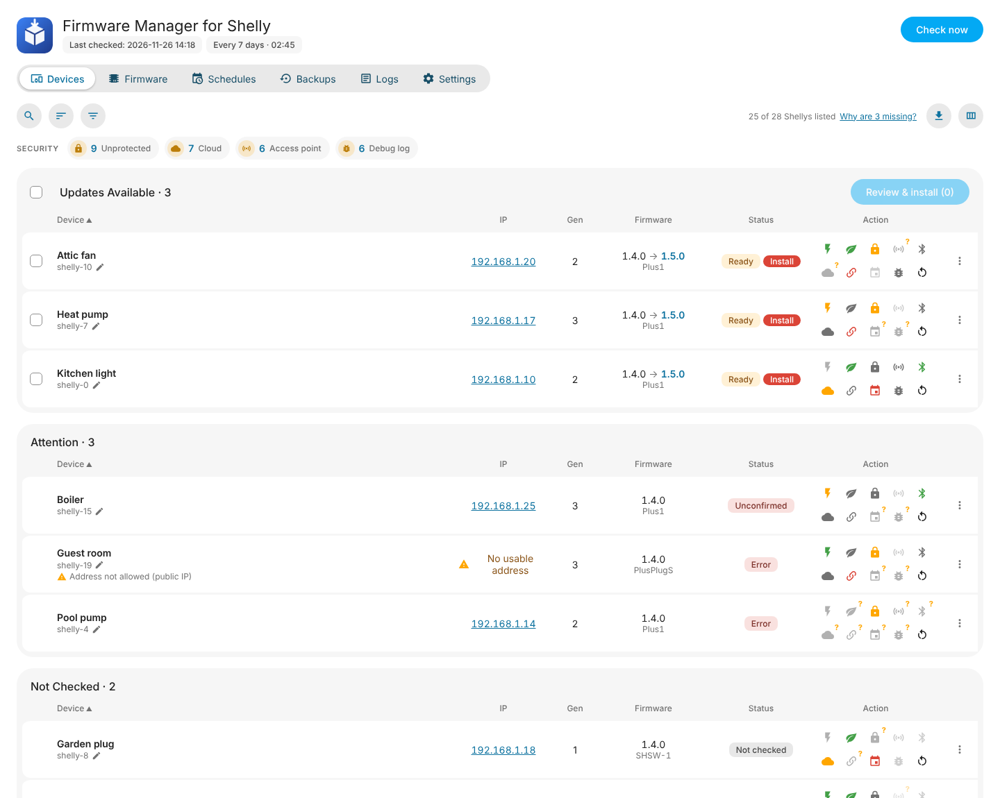
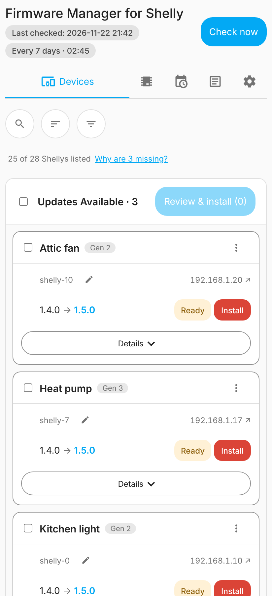

  <picture>
    <source media="(prefers-color-scheme: dark)" srcset="docs/images/logo-dark.png">
    
  </picture>

# Firmware Manager for Shelly

Home Assistant app that keeps your Shelly devices (Gen1 to Gen4) up to date – locally
and under your control. It finds all Shellys of the Shelly integration, checks for new
stable firmware, downloads it and serves it to the devices from its own download server
in your network. Nothing is installed without your approval.

  

## Features

- Shellys only talk to Home Assistant – they need no internet access.
- Every installation is approved manually and verified afterwards.
- Gen2+: the Shelly update server names the next step (also required intermediate
  versions); a stored file of that version is used instead of a download. Gen1: stored
  firmware comes first.
- Older firmware versions stay stored and allow a downgrade (Gen2+, once switched on).
- Device settings such as name, NTP server, power-on action, eco mode, password
  protection and the websocket debug log can be edited directly.
- The firmware store moves to another Home Assistant instance as one sealed ZIP file;
  device passwords can be stored or set on several devices in one step.

## Requirements

- Home Assistant OS or Home Assistant Supervised (apps need the Supervisor; Home
  Assistant Container and Core cannot run apps), version 2026.10 or newer.
- A 64-bit system: `aarch64` (e.g. Raspberry Pi 4 or 5) or `amd64`.
- The Home Assistant Shelly integration – the app works with the devices it knows: Shellys
  on Wi-Fi/LAN. Not supported: Shelly BLU, Zigbee, Matter and MQTT-only devices (Gen4
  with Zigbee/Matter firmware only when also set up in the Shelly integration).
- The Shellys must reach Home Assistant on TCP port 8098.

Only original Shelly firmware is supported. More limits:
[Known limitations](shelly_firmware_manager/DOCS.md#known-limitations).

## Installation

1. Add this repository to your Home Assistant app store:

   

   Or by hand: **Settings → Apps → App store → ⋮ → Repositories**, enter
   `https://github.com/g4mm3lHa/Shelly-Firmware-Manager` and click **Add**.
2. Open **Firmware Manager for Shelly** in the app store and click **Install**.
3. Start the app and set the **download base URL** in its Settings tab – see
   [Quick start](shelly_firmware_manager/DOCS.md#quick-start). Installations on Shellys
   are disabled until it is set. This badge opens the app page in your Home Assistant:

   

Updates of the app are offered by Home Assistant like for any other app.

## Documentation

- [User documentation](shelly_firmware_manager/DOCS.md) – also the Documentation tab of
  the app page in Home Assistant. It covers the configuration, every tab,
  [troubleshooting](shelly_firmware_manager/DOCS.md#troubleshooting) and a
  [FAQ](shelly_firmware_manager/DOCS.md#faq).
- [Version history](shelly_firmware_manager/CHANGELOG.md)

## Privacy and security

The app connects only to your Shellys in your private network, to the Shelly servers
below `shelly.cloud` (version offers, firmware, changelogs) and to Home Assistant. Only
the firmware ID and, for Gen2+, the installed version are sent to Shelly. The user
interface loads nothing from the internet, and there is no telemetry. Details:
[Privacy and network connections](shelly_firmware_manager/DOCS.md#privacy-and-network-connections)
and [Security](shelly_firmware_manager/DOCS.md#security).

## Support

1. Look up the message in
   [Troubleshooting](shelly_firmware_manager/DOCS.md#troubleshooting) and the
   [FAQ](shelly_firmware_manager/DOCS.md#faq).
2. Questions and discussion: the
   [Home Assistant community thread](https://community.home-assistant.io/t/firmware-manager-for-shelly-devices/1035784).
3. Found a bug or miss a feature? Open an
   [issue](https://github.com/g4mm3lHa/Shelly-Firmware-Manager/issues/new/choose). A
   bug report needs the versions of the app and of Home Assistant, the Shelly model and
   generation, and the entry of the activity log.
4. Security problems are not reported in public issues – see
   [`SECURITY.md`](SECURITY.md).

Problems of Home Assistant itself or of the Shelly firmware belong to those projects.

## Contributing

Pull requests are welcome after the change was agreed on in an issue. Setup, checks
and rules: [`CONTRIBUTING.md`](CONTRIBUTING.md).

## License

Released under the [MIT License](LICENSE). Components used and their licenses are listed
in the [credits](shelly_firmware_manager/DOCS.md#credits).

This is an unofficial community project. It is not affiliated with, endorsed or sponsored by
Allterco Robotics or Shelly. Shelly is a trademark of its holder.

Developed with AI assistance; every change reviewed by the maintainer.
